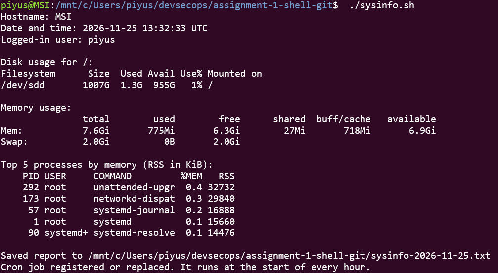
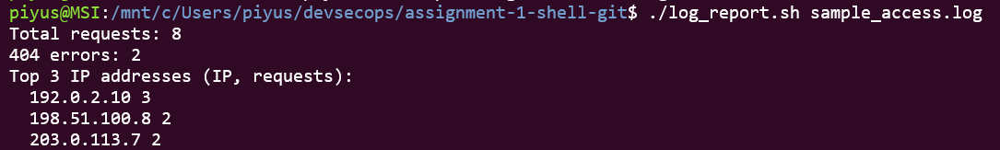
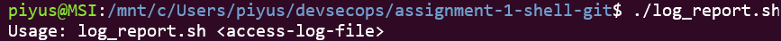
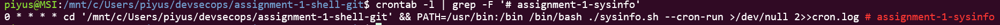

# Assignment 1 · Linux Shell Scripting and Git

This repository contains two Bash scripts. `sysinfo.sh` reports Linux system information, and `log_report.sh` summarizes a web server access log.

## Setup

Run these commands from the repository root in Ubuntu or Ubuntu on WSL. Install and start cron for the hourly report, then make both scripts executable.

```bash
sudo apt update
sudo apt install -y cron
sudo service cron start
chmod +x sysinfo.sh log_report.sh
```

## System report

```bash
./sysinfo.sh
```

The script reports the hostname, current date and time, logged-in user, disk usage for `/`, memory and swap usage, and the five processes using the most resident memory (RSS). It saves the report as `sysinfo-YYYY-MM-DD.txt` in the project folder.



## Access-log report

```bash
./log_report.sh sample_access.log
```

Pass a Common or Combined access log as the argument. The script reads the client IP and HTTP response status, then prints the total requests, the number of `404` responses, and the three busiest IP addresses. With the included practice log, the expected result is **8 requests** and **2 errors**.



### Usage message

```bash
./log_report.sh
```

With no file argument, the script prints a usage message and exits with status `2`.



## Hourly cron job

A manual run of `./sysinfo.sh` adds or replaces this assignment’s cron job. The schedule `0 * * * *` runs at the start of every hour. The scheduled run uses `--cron-run` to refresh the dated report. It keeps one report per day and redirects scheduled errors to `cron.log`.

```bash
crontab -l | grep -F '# assignment-1-sysinfo'
```



To verify a scheduled run, keep Ubuntu and the cron service running. Compare the report timestamp before and after the start of the next hour without running `sysinfo.sh` manually in between.

```bash
stat -c '%y %n' "sysinfo-$(date +%F).txt"
```
